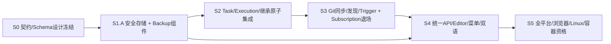

# 实施路线与重新资格认证

本文是下一轮实施任务的输入，**不是 S1–S5 实施授权**。S0 已获本轮设计/决策收束/隔离验证授权，见 [S0 合同](S0_TECHNICAL_CONTRACT.md)、[ADR](S0_DECISION_RECORD.md)、[精确阶段门](S0_ACCEPTANCE_GATES.md)及[S0 报告](S0_REVIEW_REPORT.md)。READY_FOR_APPROVAL 不是 APPROVED，完成 S0 后停止。

## 实施顺序和集成纪律

不采用“先创建 LOCAL，最后再补备份”的顺序。路径防护、同一 Workspace lease、backup manifest/恢复与首个本地持久资产同阶段实现。Subscription 退场与其策略/调度/发现/默认值/权限消费者的替换应作为同一域切换门，而不是先删 Service 再搬 Cron。

阶段是可独立代码审查/隔离自动化验收的工程增量，**不是每阶段部署一个不完整模型**。S1–S3 使用隔离 fresh-v2 fixture/data root 与候选 schema，不能让现有 v9 服务连接尚未完成的 v2 schema，也不向用户开放未能备份的本地目录。一次 source/lock/schema epoch 必须由所有生产消费者共同采用；禁止 worktree 与 workspace 两套锁同时保护同一目录。S4 完成才形成全功能候选，S5 完成才有资格申请另行发布授权。

人工批准前只在 S0 文档 contracts 目录设计候选 DDL 并用 SQLite 内存验证，不写实际 schema/ORM/启动；若分多个 PR，可先合入未接线的类型/独立组件和测试，生产入口与 schema epoch 的接线只能在完整依赖通过后一起完成。不通过兼容旧 QingLong 或新增 legacy bridge 解决阶段不一致。

## S0：冻结接口、状态机和数据约束

- **目标**：接受/调整方案 A；冻结 Workspace/GitWorkspace、TaskSource、lease、ENV/Profile/Config、SyncRun/outbox/trigger、backup format、错误码和删除契约。
- **文件/实体**：本目录；拟新增 Workspace DTO/model/schema spec；`back/data/{task,taskRun,worktree,subscription,scopedEnv,configAsset,discoveryPolicy}.ts` 的差异设计；`operationalSchema`/`taskSchema`/`triggerSchema` 所有约束。
- **前置**：人工阅读本评估；D1–D5、D7–D9 技术决定。新产品模式不再讨论。
- **风险**：把 Source 别名重命名误作领域替换；把 fresh-only 当删库授权；同 ref 隐式共享目录。
- **自动化验证**：在内存/隔离 DB 验证拟定 FK、CHECK/guards、unique keys、删除 RESTRICT 和事务回滚；生成显式字段读写/owner 契约对照。不得更改旧 frozen schema 文件。
- **完成标准**：每个现有 Subscription 能力都有唯一承接 owner；13 条旧 FK 和 11 个核心表的目标明确；锁序、状态机、恢复与版本失败语义无空白；所有待定项记录结果。
- **独立验收**：可以，设计验收；不可部署。**Schema/契约**：只冻结设计，实施授权后进入后续阶段。

## S1：安全 Workspace 存储与核心备份一起落地

- **目标**：通用身份/生命周期、LOCAL 系统分配目录、Git 扩展接口、通用安全文件操作；同阶段完成 LOCAL backup/restore。
- **文件/实体**：新增 Workspaces/GitWorkspaces、WorkspacePathResolver/WorkspaceService；调整 `workspaceFiles.ts`、`workspacePaths.ts`、`bootstrapDirectories.ts`、`workspaceLocks.ts`、必要 POSIX helper；`backup/{inventory,coordinator,validator,git,restore,schemaIdentities,paths}.ts` 与 manifest/加密出口。Git adapter 只保留真实 Git 语义。
- **前置**：S0 的 root/key/type/FK/manifest/quota 契约；首次本地写入前已有备份测试。
- **风险**：路径/父目录 symlink race、hardlink、任意宿主机路径、半创建/半删除、DB ID 与恢复目录不符、DB 恢复但代码缺失、备份超额。
- **自动化验证**：LOCAL 创建与重启；文件/目录 CRUD/search/CAS/atomic write；traversal/links/device 拒绝；Backup snapshot 竞态；仅存本地脚本的源实例 A 被销毁后，在不同数据根 B 恢复且 hash、IDs、引用一致；缺代码/篡改/加密失败拒绝；创建/保存/恢复各断点 kill/restart。
- **完成标准**：所有持久文件归数据库 Workspace ID，root 不可用户写；孤儿与恢复未知状态 fail closed；本地核心代码已进 manifest 和 validator，而非只进入 tar；没有活动写锁时才能切换恢复目录。
- **独立验收**：可用隔离文件/备份 harness；无用户公开入口。**Schema/契约**：实施新基础表、类型 guards、backup format；不升级用户数据根。

## S2：Task、执行引擎及继承原子解耦

- **目标**：LOCAL/GIT 同一 TaskSource/readiness/execution；统一 lease/key/context；Workspace Runtime/ENV/Config 承接全部默认。
- **文件/实体**：`data/task.ts`/`taskRun.ts`/`scopedEnv.ts`/`configAsset.ts`；`shared/{taskDefinition,execution,scopedEnv}.ts`；`services/task*`、`execution*`、`runnerV2`、`configMaterialization`、`hookExecutor`；Runtime/environment references；backup resources validation；SQL task/execution guards。
- **前置**：S1 安全路径、备份、lease；Task/Workspace 删除策略和 profile 选择契约。
- **风险**：仅改 source DTO 遗漏 SQL guards；新旧锁 inode 分裂；排队到执行间源码变化；跨 Workspace profile；注入秘密残留；Host runtime fallback。
- **自动化验证**：两类型 Python/JS/TS/Shell 正常/失败/超时/取消/重试；Task 创建编辑 clone 删除、引用计数和 readiness；Workspace 默认与 Task 覆盖；Global/Profile/Task SET/UNSET/secret；Config ATTACH/MASK 和 Hook 各 phase；执行与编辑/同步排他；SIGKILL 后 child FD/注入/临时目录/TaskRun 收敛；恢复后的 TaskSource 可解析。
- **完成标准**：生产候选 Task 不再要求 Repo/Sub/Worktree；Resolver 到 Runner 全链只收 Workspace root/ID；同目录只有一把锁，config 恢复键与备份一致；source_snapshot 如实区分 LOCAL/GIT；所有托管 Runtime 资格保留。
- **独立验收**：可，隔离 API/service+真实 managed runtime；无全产品部署。**Schema/契约**：TaskSource/TaskRun、owner FK/索引/SQL guards、profile/config/default 模型在同一 epoch 集成。

## S3：Git Workspace 同步、发现及 Subscription 退场

- **目标**：按 Workspace 策略 Cron/interval/manual 同步；SyncRun/成功事件；发现协调与 GitUpdate 幂等；取消独立 Subscription 业务面。
- **文件/实体**：`subscription.ts`/`subscriptionGit.ts`/`managedSubscription.ts` 职责移入小服务；`worktree.ts`/`repositoryStorage.ts`；`discovery.ts`/`discoveryScanner.ts`/`gitUpdateTrigger.ts`/`triggerEvents.ts`；`gitSubscription.ts`/`initTask.ts`/scheduler；新 SyncPolicy/SyncRun/UpdateOutbox/DiscoverySuppression；清除 Runtime/ENV/Config/日志/保留策略的 Sub 引用。
- **前置**：S2 完整 Workspace Task；S1 backup 支持 Git 扩展；私有 branch/源 generation/状态机/调度 occurrence 唯一键已冻结。
- **风险**：ensure 复用目录；Repo 锁与 Workspace 锁逆序；重复调度、失败同步发事件；Tag 移动误更新；USER Cron 被覆盖；删 Subscription 误删任务；同 commit 重试重复运行。
- **自动化验证**：同 repo/ref 双 Workspace 独立运行/编辑/Runtime；Branch safe FF，dirty/ahead/diverged/conflict 拒绝；Tag/Commit 固定；manual 与 schedule 抢占同一 policy；同步每个断点 SIGKILL 重启；同 commit 多次 sync、outbox 重投、source 被后续 sync 推进；discovery 用户字段/Cron tombstone/脚本消失重现/忽略项；无 GitUpdate 配置则零 TaskRun。
- **完成标准**：每项 Sub 职责在新 owner 下测试通过；触发只来自成功持久更新，SyncRun 与 TaskRun 不可混淆；所有消费清点后才能删除旧类/model/API/menu scope，不能删用户历史日志或目录；git 工作树不伪装 Local。
- **独立验收**：可，完整后端候选；尚未给旧 UI 接不兼容 API。**Schema/契约**：完成新 epoch，去 Sub 业务表与旧 FK；冻结 sync 状态/历史/error、discovery 唯一键、outbox 与 trigger payload。实际文件级 REMOVE 见 Inventory；不是删除授权。

## S4：统一公开 API、Editor 与前端体验

- **目标**：脚本工作区列表/详情统一，LOCAL 基本网页能力完整，GIT 扩展；Task 创建不要求 repo；菜单/路由/权限/双语同步。
- **文件/实体**：`back/api/{workspace,codeWorkspace,gitResources,subscription,discovery,tasks,taskTriggers,scopedEnvironment,configAssets}.ts` 与实际注册/auth；WorkspaceFile/Git 扩展；`src/pages/{workspace,repository-workspace,tasks,repository,subscription,...}`、components、layouts、App scopes、两 locale 与 ui-catalog。
- **前置**：S1–S3 完整新域；公开 API/CAS/error/auth 测试已准备；LOCAL 写入备份 gate 已过。
- **风险**：现有 workspaces 路径其实 Worktree ID 引发误引用；GET 泄露注入秘密；Git identity 误标 owner；/open rewrite 意外放行；convention 路由暴露 helper；旧菜单消失而能力未承接。
- **自动化验证**：API 未认证/错误 scope/类型非法/版本冲突/删除引用；双用户 save 竞争；浏览器 LOCAL 创建 → 编辑 →Task→Trigger→ 运行 → 日志；GIT 创建 → 同步/历史/发现/Git 操作；Workspace 环境配置；深链/登录/404/移动布局；zh-CN/en-US；Notification/Backup UI 端到端。
- **完成标准**：冻结 10 个主入口可达；无 Subscription 或独立 Code Workspace 业务入口；Git 仓库仅来源配置；所有真实页面路由有目标归属；没有“先建 Git 才能运行 Local”的表单验证；无上传 ZIP 前置要求。
- **独立验收**：可以，全功能 fresh candidate，不代表发布。**Schema/契约**：公开 DTO/error/permission/route 冻结，不再引入域变化。

## S5：重新获得平台及双架构资格

- **目标**：以同一新源码 HEAD 与候选镜像重做所有门；保留所有旧阶段报告原样。
- **文件**：测试基线与 fixtures、`scripts/ci/*`、`scripts/qualification/*`、`scripts/release/*`、实际诊断可执行 harness、Linux/container workflows、Dockerfile/compose/entrypoint；更改仅限实现任务授权的范围。
- **前置**：S4 候选冻结；新 suite 纳入 active manifest；无未处理 critical 风险或 UNVERIFIED 核心恢复边界。
- **风险**：旧镜像冒充新源码；跳过 test 被汇总成 PASS；不同 arch/HEAD receipt 混用；诊断文件含 secret；scale/backup 耗尽盘。
- **自动化验证与完成标准**：下表每门均绑定新 HEAD、环境、run ID；0 失败/0skip（明确不适用必须单独签核），收集/清理/上传也必须成功；真实 amd64 与 arm64 分别产物与镜像 digest；漏洞和 secret gate 通过。禁止发布/tag/push，发布需另行授权。
- **独立验收**：可以，工程发布资格验收。**Schema/契约**：不再调整，若调整则重跑受影响门并更新 receipt。

## 必须重跑的正式门

| Gate                    | 当前实际入口/证据源                                                                          | v2 必须增加/保留                                                                                   | 此次评审状态              |
| ----------------------- | -------------------------------------------------------------------------------------------- | -------------------------------------------------------------------------------------------------- | ------------------------- |
| TypeScript / Build      | package.json 的 `typecheck`、`build:back`、`build:front`；`scripts/ci/ci.cjs` typecheck/core | 源 DTO/SQL 类型/新页面全编译；前后端 build 均成功                                                  | NOT RUN，文档评审不产资格 |
| Platform Tests          | `node tests/platform/run.cjs` + `tests/platform/test-baseline.json`                          | 新 Workspace/LOCAL/TaskSource/sync/discovery/refs/恢复 suite；分类活跃 suite 全跑                  | NOT RUN                   |
| Managed Runtime         | `scripts/ci/run-job.sh managed-runtime`                                                      | Python/Node 真实安装、依赖环境、两类型 workspace；无 host fallback                                 | NOT RUN                   |
| Phase12 Browser         | `diagnostics/phase12/browser-e2e.cjs`；CI browser 实际调用                                   | 原 Git 文件/冲突/commit/push + LOCAL 全流程与执行锁                                                | NOT RUN                   |
| Phase13 Notification    | `tests/phase13/*`，Phase14 platform-e2e 涵盖 UI 事件链                                       | 新 Workspace TaskRun 通知/secret/outbox/delivery/retry；SyncRun 不伪造成 TaskRun 通知              | NOT RUN                   |
| Phase14 Backup/Restore  | `tests/phase14/*`、`diagnostics/phase14/platform-e2e.cjs`                                    | LOCAL 唯一源丢失后重建、DB 有源缺、跨根、加密、七点 kill 与 Workspace 校验                         | NOT RUN                   |
| Linux Qualification     | `.github/workflows/linux-qualification.yml` → `scripts/qualification/run.cjs`                | POSIX FD/flock、lease 继承、SIGKILL、socket/restore/规模，在新 source 下执行                       | NOT RUN；Darwin 不可替代  |
| Container Qualification | `.github/workflows/container-qualification.yml`，container-acceptance/compose-test           | 新 source 构建的镜像；空 volume/非 root/目录权限/重启/运行+备份恢复；不得使用旧镜像 receipt        | NOT RUN                   |
| AMD64 / ARM64           | container workflow 两个 native runner 与 qualification-summary                               | 各架构运行上述资格、digest/arch/commit/run 匹配，不以 emulation 或单架构代替                       | NOT RUN                   |
| Security Gates          | CI static/evidence scrubber、i18n tests、container Trivy gate                                | traversal/symlink/hardlink/ZIP(若启用)、Git 权限/secret、注入/备份恢复、依赖扫描；不在本轮升级依赖 | NOT RUN                   |

旧 Phase15/16A/16B 证明其历史基线，不能证实 v2。验收执行命令以现有 workflow 及其脚本为准，不直接绕过隔离/系统依赖/清理机制运行 diagnostics 操作用户目录。新增测试名称由实施时确定，本文描述的用例是要求，不冒称已有测试。

## 功能成本与后置范围

| 增量             | 工作范围                                                                                                                                | 依赖/验收                                                                        |
| ---------------- | --------------------------------------------------------------------------------------------------------------------------------------- | -------------------------------------------------------------------------------- |
| 必须 MVP         | LOCAL 网页基本文件操作、搜索、Task/Runtime/Trigger 运行；GIT 统一；备份安全全链                                                         | S1–S5，不能砍安全/backup 换“先可用”                                              |
| 上传（增强）     | 认证/streaming staging、容量计费、类型/链接拒绝、扫描、原子发布、失败清理、双语 UI                                                      | S1 文件与 backup quota；约小至中型独立增量，需压力与中断测试；不承诺未经估算工期 |
| ZIP（增强）      | 安全解压 sandbox、逐成员验证、解压比/总 bytes/files/depth/time 限制、路径重名/Unicode 冲突、symlink/hardlink/device 拒绝、原子安装/回滚 | 大于单文件上传；中至大型独立增量；ZIP Slip/bomb/中断/磁盘耗尽与备份测试必须通过  |
| LOCAL discovery  | Workspace scanner 可复用，但事件来源、编辑抖动与用户覆盖需另设计                                                                        | MVP 以后；不作为 LOCAL 运行前提                                                  |
| 并发执行源码快照 | 快照/overlay、cache、备份/secret/GC/运行复现语义                                                                                        | 单独 ADR；不以此阻塞排他 lease MVP                                               |

工期、人力和性能 SLO 为 UNVERIFIED；按本路线拆具体实施任务后估算。各阶段失败均停在隔离 candidate，保留当前用户数据根和历史证据；不采用 reset/clean/delete 用户内容作为回滚。

## S0 收束后的阶段退出补充

S1.A 组件可独立验收，完整 S1 资产门 S1.B 依赖 S2 真实 v2 Task/Runner 完成“LOCAL 文件 →Task→Run→Backup→ 销毁 A→ 异根 B Restore→Run”。不得用旧 Worktree Source 或测试桩冒充；S1.B 之前不具备正式 LOCAL 持久写入口资格，S4 也须依赖此门。新 schema/lease/journal 必须同 epoch 集成，existing v9 用户根不被自动升级或清空。

D8 按 S0 身份/磁盘分离：历史 Run/SyncRun 的 RESTRICT 只阻 metadata purge，不阻满足 live 引用/所有权/保全 hold 条件后的目录回收。D3 单 Runqueue、D9 三事实/原子对账和每阶段 Preconditions/Deliverables/Invariants/Tests/Failure/Exit/Stop 的完整可测试合同，以 [S0_ACCEPTANCE_GATES](S0_ACCEPTANCE_GATES.md) 为准。S0 候选 READY 不代表批准 S1。
