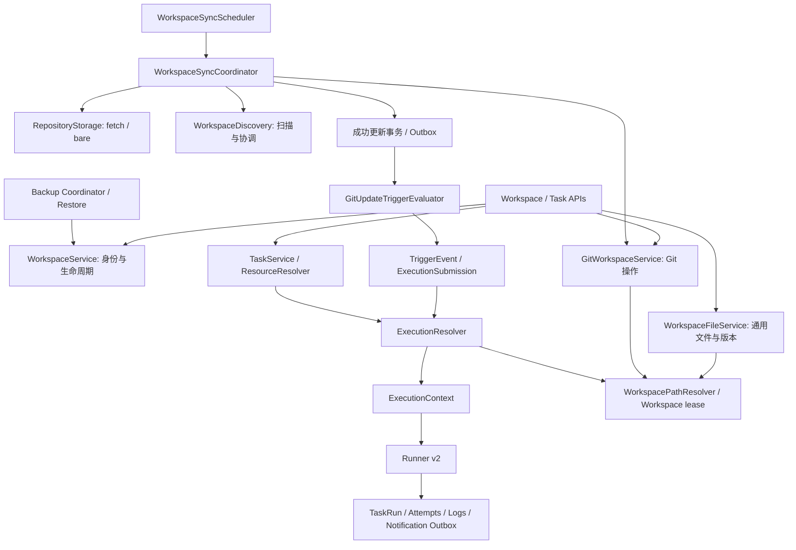

# ZhiXu Architecture v2.0 — Target Freeze

状态：**产品原则 PRODUCT_FROZEN；技术候选 TECHNICAL_CONTRACT_READY_FOR_APPROVAL；尚未批准或实现**。S0 权威入口为 [S0_TECHNICAL_CONTRACT](S0_TECHNICAL_CONTRACT.md)，D1–D9 见 [正式 ADR](S0_DECISION_RECORD.md)。具体 DDL/DTO/状态以 S0 合同为准，旧评估的推荐不再作为并列可选规范。

本目录对应任务“Architecture v2.0 Target Freeze & Migration Impact Assessment”。基线 `develop@d527a46095e85b7fc61c83544cd847a6e3f237db`，初始工作区干净。本轮仅新增架构报告，不改变 v9 数据库或现有程序行为。本文是 v2 产品定位的规范依据；既有 1.0 freeze、ADR-003/004 和历史阶段报告仍是历史/现状证据，不能反向覆盖本次用户明确冻结的方向。

## 已冻结、不得重新开放的产品约束

ZhiXu 是**通用脚本管理与自动化任务调度平台**。Git 是代码来源之一，不是任务前置条件。正式模式为 LOCAL 与 GIT，统一经过 `Workspace → Task → ExecutionContext → Runner → TaskRun / Logs`。

| 约束         | 冻结结果                                                                                                                                    |
| ------------ | ------------------------------------------------------------------------------------------------------------------------------------------- |
| LOCAL        | 直接创建系统分配的持久目录；网页创建目录、创建/编辑/重命名/删除/搜索脚本；无需 Repository、Credential、Git 初始化、Worktree 或 Subscription |
| GIT          | Repository + Branch/Tag/Commit；Workspace 管理同步策略、状态、历史、可选发现；Worktree 为真实 Git 内部机制                                  |
| Workspace    | 持久业务资源，同时是文件和执行根；Code Editor 是其界面，不能成为另一套业务实体                                                              |
| Subscription | 从目标业务实体、API、权限作用域与菜单中移除；必须先承接其所有有效职责                                                                       |
| TaskSource   | `WORKSPACE_ENTRYPOINT + workspace_id + relative_entrypoint`；保留 language、cwd_mode、cwd_relative_path                                     |
| 同步与执行   | Git 同步记录为 WorkspaceSyncRun；绝不自动等价于脚本运行，只有显式 GitUpdate Trigger 可产生运行                                              |
| Runtime      | Workspace Default → Task Override（覆盖优先）；不引入 Host Python/Node fallback                                                             |
| 数据和安全   | 不删除既有用户数据；保留同一 inode 的执行租约、路径与 symlink 保护、materialization 恢复、runtime 隔离和一致备份                            |
| 本地源文件   | 核心用户资产；首次对用户开放持久写入时必须同时具备有效备份/恢复                                                                             |
| 部署方向     | fresh install / fresh schema；不建立 QingLong 迁移、旧 API 兼容、假 Git Local 或 scripts staging 依赖                                       |

## 推荐物理模型：方案 A

逻辑资源接口统一，物理模型采用 `Workspaces + GitWorkspaces`。Git 扩展以 `workspace_id` 为共享主键，吸收当前 Worktrees 的 Git 持久状态；不再增加第三个独立公开 Worktree 资源。保留 WorktreeService 的 Git 适配职责，不把它泛化成 LOCAL 文件服务。

| 方案                   | 优点                                                                              | 成本/限制                                                                                          | Task / Runner / Backup / Locks                                                      |
| ---------------------- | --------------------------------------------------------------------------------- | -------------------------------------------------------------------------------------------------- | ----------------------------------------------------------------------------------- |
| A：统一表 + Git 扩展   | Task 有单一 FK，LOCAL 无 Git nullable 垃圾字段；Git 独立唯一性/状态约束；边界清晰 | 两表生命周期需事务和故障日志；类型与扩展存在性需应用与 SQL guards 一起保证                         | 单一 workspace_id / 类型无关 root / 分类型 manifest / 单一 workspace 锁键。**推荐** |
| B：统一表 + 专属字段   | 列表查询简单，少一次 join                                                         | repo/ref/Git 状态/push/sync 多组 nullable；CHECK 随字段扩张，容易让 LOCAL 依赖 Git；表成为多域聚合 | FK 仍简单，但 resolver 与备份到处判断字段组合；拒绝作为主方案                       |
| C：统一接口 + 两套存储 | LOCAL/GIT 可分别演进，适配现有 Worktree 容易                                      | Task 多态引用缺少自然 FK；跨类型 ID/列表/删除、锁和恢复需注册表，最终又造统一 Workspace            | Task 引用完整性、恢复 ID、锁命名最复杂；本项目无独立分库需求，不推荐                |

建议字段与约束（**设计，非 DDL**）：

| 聚合                  | 建议字段/关系                                                                                                                       | 不变量                                                                          |
| --------------------- | ----------------------------------------------------------------------------------------------------------------------------------- | ------------------------------------------------------------------------------- |
| Workspace             | id, name, type, root_key, lifecycle_state, version, content_revision, source_generation, default_env_profile_id, created/updated_at | type=LOCAL/GIT；root_key 服务端分配；API 不接受 local_path；type 创建后不可切换 |
| GitWorkspace          | workspace_id PK/FK, repository_id FK, ref_type, ref_name, resolved_commit, applied_commit, private_branch, git_lifecycle/error      | 只存在于 GIT；每 Workspace 一份工作树；本地 private_branch 按 Workspace 唯一    |
| WorkspaceSyncPolicy   | workspace_id 唯一, mode, schedule_kind, cron/interval, timezone, version, next_fire_at                                              | Branch 允许 MANUAL/SCHEDULED；Tag/Commit 仅固定 SHA，不追踪更新                 |
| WorkspaceSyncRun      | id, workspace_id, started/finished_at, before/after_commit, status, error_code, trigger_source, request_key, policy_version         | 与 TaskRun 分离；受理成功不等于更新成功；相同调度 occurrence/request_key 唯一   |
| WorkspaceUpdateOutbox | workspace_id, source_generation, after_commit, sync_run_id, delivery state                                                          | 只在成功落库事务写入；独立重试，不重新同步或伪造成功                            |
| Task/发现             | TaskSource.workspace_id；发现 owner 同 Workspace；workspace_id + discovery_key 唯一                                                 | MANUAL Task 无发现 owner；用户所有字段不被发现覆盖                              |
| 继承                  | Workspace RuntimeDefault、EnvironmentProfile、WorkspaceConfigBinding                                                                | Repository 只管理来源/凭证，不再承担执行继承                                    |

逻辑模型中的 local_path 保留为服务端解析结果/受限诊断字段，不能作为可写身份。建议 LOCAL `DATA_DIR/workspaces/local/ws-{id}`，GIT `DATA_DIR/workspaces/git/ws-{id}`，bare repository 继续归独立 Git storage。具体布局统一由 WorkspacePathResolver 生成；备份保存 root_key 与相对成员，不导入原宿主机绝对路径。锁放在稳定 `.locks/workspace-{id}.lock`；恢复重建锁而不复制锁文件。

S0 D8 将身份历史与源码磁盘分开。DELETE 在 admission/lease 内复查 TaskSource 及活动 Run/Sync/file/journal/recovery；有 live 引用时 409 且原状态不变，不级联删除 Task。历史 TaskRun/SyncRun RESTRICT 指轻量 Workspace identity/tombstone，**不阻物理源码回收**。无 live 引用、owner 可证明且保全 snapshot/hold 覆盖当前 gen/rev/hash 后，durable operation 推进 DELETE_REQUESTED→TOMBSTONED、storage PRESENT→RECLAIMING→RECLAIMED；历史仍可读。最终 metadata purge 另受历史/retention/hold/GC 条件约束。非空 LOCAL 及 GIT 回收默认需要保全备份，不存在 force 绕过。见 [S0 Backup/D8](S0_BACKUP_RESTORE_CONTRACT.md)。

## 服务职责和调用边界

WorkspaceService 不负责 Git argv、Cron、源码扫描、Runtime 构建、配置注入、Runner 或备份复制。WorkspaceReadiness 组合各域诊断而不拥有它们。通用文件服务可以复用 WorkspaceFiles 的安全基础，但不能复用 CodeWorkspaceService 中要求 Repository/Git 的 access 编排。

## 文件版本、执行和并发

MVP 使用同一 Workspace 排他执行租约，不是最终并发架构或代码 snapshot。执行期间禁止编辑/冲突 Git 写，文件读取/搜索也全程同租约，防临时秘密可见。S0 只用 TaskRuns 一个 durable 队列；Task FORBID/QUEUE/ALLOW 与资源 WAIT/SKIP/FAIL_FAST 分层，自动触发 WAIT，手动可选择；有 deadline/cap/cancel/restart 规则，详见 [S0 Execution](S0_EXECUTION_LOCK_CONTRACT.md)。不同 Workspace 可并行，同 Workspace 不同 Task 仍不能并行。锁序为可选 backup catalog EX→platform admission→Repository（需要时）→Workspace→runtime pins，不得反向等待。未来 snapshot/overlay 须独立 ADR 和资格。

提交记录保存 Workspace 类型/ID、source_generation、content_revision、Task definition version、入口/CWD、Git commit（仅 GIT）、入口内容 hash、有效 Runtime revision 与非秘密配置标识。拿到租约后再次校验来源；不匹配则 TaskRun 为 SKIPPED / SOURCE_SUPERSEDED，不注入、不启动 Runner、不自动换为最新源重试，新的执行必须由新事件或用户显式重提产生。完整代码归档 snapshot 不是本轮冻结功能；入口 hash 不能被描述为所有间接 import 的完整可重现性证据。详见 [EXECUTION_AND_BACKUP](EXECUTION_AND_BACKUP.md)。

## 同步语义

Branch 只允许安全 FF，dirty、ahead/diverged、缺失源、恢复待处理、活动租约均阻断；绝不自动 reset/clean。Tag 创建时解析并固定 Commit，之后远端 tag move 只更新 refs 诊断；Commit 创建时验证并固定 SHA。手动同步与定时同步共用 coordinator 和 request/occurrence 幂等，不再提交 Subscription 调度任务到 TaskRun。

每个 Git Workspace 拥有独立工作树/私有本地分支；同 Repository/ref 可创建多个 Workspace，fetch 共享 Repository 锁。Discovery 关闭则跳过；开启时 scan/reconcile/版本冲突阻断成功提交。Git 已应用但发现或数据库提交失败时，记录 `RECOVERY_REQUIRED / APPLIED_PENDING_RECONCILIATION`，区分 journal 的 last_verified_commit 与已完成对账的 applied_commit，阻止新执行及写入，不发 outbox。恢复核验实际 HEAD=journal.target 后重做幂等对账，不 reset；最终在同一事务写对账结果、applied_commit、SyncRun SUCCESS 和 update outbox。事件派发在成功事务之后；相同 `(trigger_id, workspace_id, source_generation, after_commit)` 不重复。见 [SUBSCRIPTION_SYNC_DESIGN](SUBSCRIPTION_SYNC_DESIGN.md)。

## Runtime、ENV、Config、Hooks

Runtime 先取 Task 显式 override，再 Workspace 对该语言的 default；未配置/不可用阻断，无 Host fallback。ENV：System Base allowlist → Global SET/UNSET → Workspace 选定 Profile → Task SET/UNSET；保留当前 Task 显式选择 Profile 时优先于 Workspace 默认的单选语义，不能同时叠加多个 Profile。Profile 必须属于当前 Workspace。GIT 分支 Workspace 配置独立，LOCAL 相同能力。

Config：Workspace ATTACH → Task 同 target key ATTACH/MASK，保留相对目标基准、revision pin、秘密隔离和注入恢复；Hooks 仍 Task 所有。S0 针对性核查发现当前 Repository Service 本就拒 MASK（表枚举不代表 Service 允许），Workspace 继承这一限制；澄清记录见 [S0 ADR C1](S0_DECISION_RECORD.md#针对性事实澄清与建议变更记录)。

## 安全及交付边界

S0 采用独立 fresh-v2 候选 identity `zhixu.workspace.v2.s0.1`；不支持旧库升级/API 兼容，现有数据绝不自动清空或导入。EMPTY DATA ROOT、SUPPORTED FRESH V2、UNSUPPORTED EXISTING SCHEMA、CORRUPTED V2 SCHEMA 有不同启动行为，见 [S0 Fresh 合同](S0_TECHNICAL_CONTRACT.md#6-d5-fresh初始化与签名)。平台现有 1→9 路径保留为源码事实，不接成 v2 自动迁移。

上传/ZIP 是增强功能，MVP 网页基础文件编辑独立验收；ZIP 路径/链接/设备/解压限额必须单列 gate。自动 LOCAL discovery 后置。全部阶段按 [IMPLEMENTATION_ROADMAP](IMPLEMENTATION_ROADMAP.md) 评审，人工批准前禁止进入实施。
